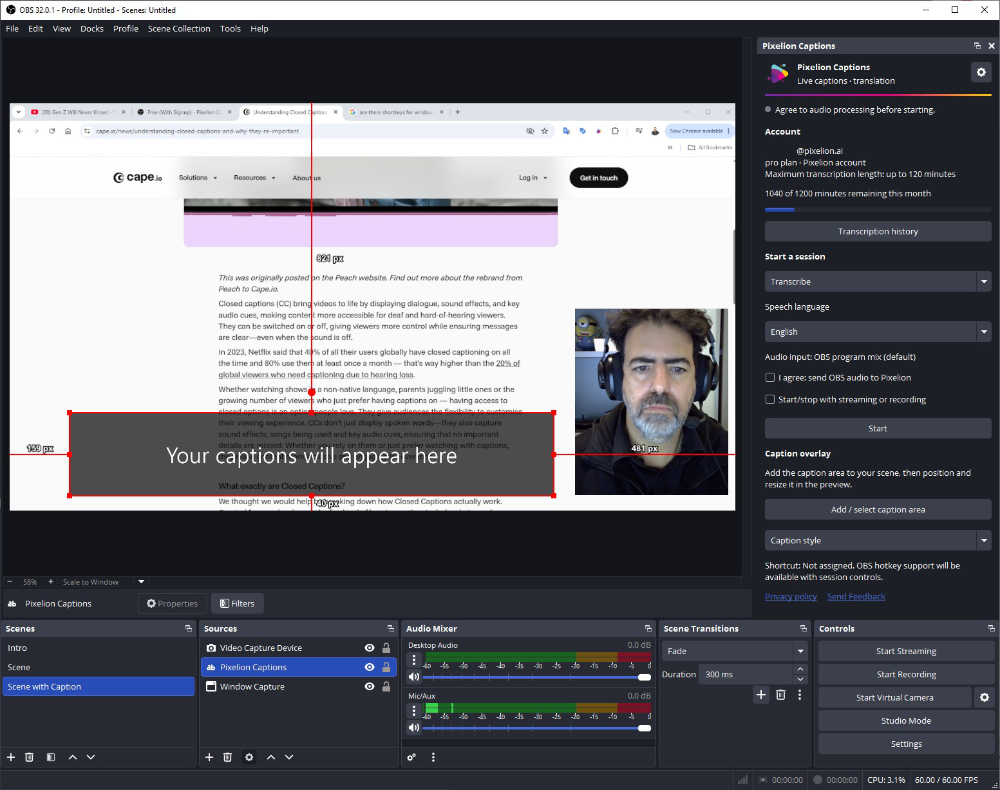
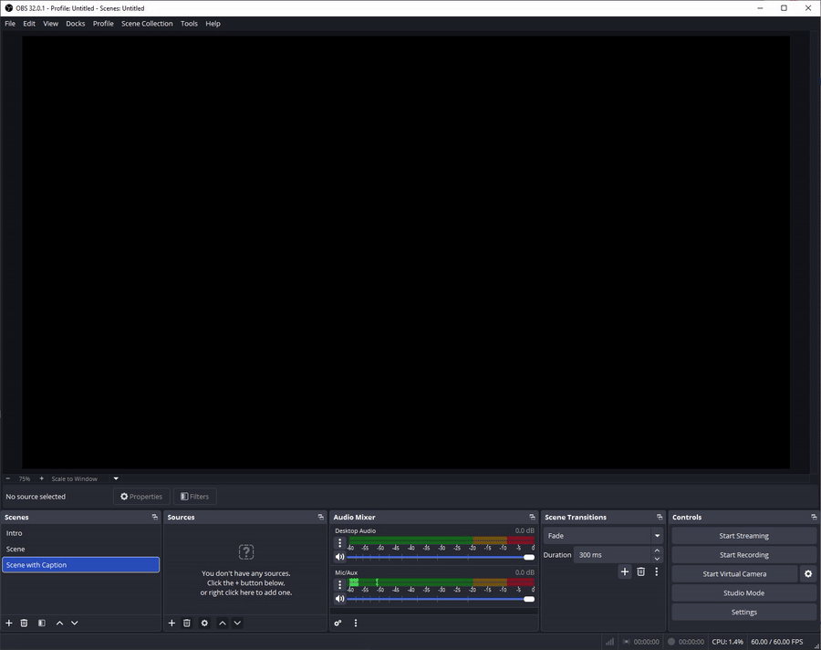

# Pixelion Captions

Pixelion Captions adds live transcription and translation to OBS Studio. It uses the audio from your OBS program mix and shows captions in a source you can place and style in your scene.

You can save transcripts on your computer, browse previous sessions, and optionally save transcripts to your Pixelion Library.

Pixelion Captions is a third-party plugin developed by Pixel Solutions. It is not part of OBS Studio and is not affiliated with or endorsed by the OBS Project.

## Screenshots

Captions shown live in a scene, over your webcam and content:

## Requirements

You need Windows x64, OBS Studio, a free Pixelion.ai account, and an internet connection. Translation requires a Pixelion Pro plan. Available minutes and session limits depend on your subscription.

The plugin has been tested with OBS Studio 32.0.1 on Windows x64. It is built against the OBS Studio 31.1.1 development dependencies. Compatibility with other OBS versions has not been confirmed. macOS support is planned. There are no plans for a Linux version.

## Install

1. Close OBS Studio.
2. Download the Windows x64 ZIP from [Releases](https://github.com/pixelsolutions/pixelion-captions/releases). Choose the plugin package, rather than the source ZIP.
3. Extract the ZIP and copy the `pixelion-captions` folder into `C:\ProgramData\obs-studio\plugins`. Keep its `bin` and `data` folders together.
4. Open OBS Studio. Open the Docks menu and select Pixelion Captions.

When updating, close OBS before replacing the plugin files. Keep your existing plugin settings and saved transcripts.

## Start using captions

1. Sign in to your Pixelion account from the dock.
2. Choose Transcribe or Translate.
3. Select the speech language. For translation, also choose the language under Translate to.
4. Check the audio processing consent box.
5. Add a Pixelion Captions source from the Sources panel and place it in your scene.
6. Press Start in the dock. Press Stop when you are finished.

The plugin uses the OBS program mix. Make sure the microphone or other audio you want to caption is included in that mix.

## Settings and transcripts

Speech language and Translate to remember your last selection when you restart OBS. You can adjust the caption font, colors, size, background, alignment, and padding from the dock.

Open Transcription history to browse saved sessions. Use the settings button to choose where local transcripts are saved and whether to save them to your Pixelion Library.

You can also enable Start/stop with streaming or recording. Automatic start still requires a signed-in account and audio processing consent. Consent must be given again after restarting OBS.

## Privacy

Audio is sent to Pixelion for processing after you give consent and start a session. Live transcription and translation require an internet connection. Local transcript saving and Pixelion Library saving are separate settings.

Read the [privacy policy](https://pixelion.ai/privacy) for more information.

## Use of AI tools

AI coding assistants were used for parts of this project, mainly to speed up routine work such as drafting boilerplate, reformatting, and suggesting fixes. The plugin was not written entirely or in large part by AI. Its design, the core transcription, translation, audio, and session logic, and the integration with Pixelion's services were directed and reviewed by human developers at Pixel Solutions, who are responsible for the released code. The plugin was also tested by multiple hands in OBS Studio before release.

## License

Pixelion Captions is developed by [Pixel Solutions](https://pixelsolutions.biz/).

Copyright (C) 2026 Pixel Solutions.

Pixelion Captions is licensed under GPL-2.0-or-later; see [LICENSE](LICENSE). Each binary release will include a matching source ZIP.

## Support

Use Send Feedback at the bottom of the dock, beside Privacy policy, or report a bug on the [GitHub issue tracker](https://github.com/pixelsolutions/pixelion-captions/issues).

For bug reports, include your Windows version, OBS version, plugin version, and the steps needed to reproduce the problem. Please leave out account tokens, private audio, and transcript contents.
